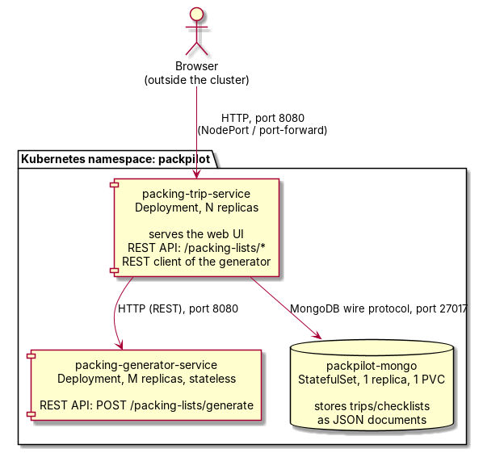

# PackPilot: Software Architecture Design

## Overview

PackPilot consists of two Spring Boot microservices and a MongoDB database, deployed as three independent Kubernetes workloads in a single namespace. The diagram below shows the components and the direction of every call between them.

The diagram's source is `docs/architecture-diagram.puml` (PlantUML), kept alongside this document so it can be edited and re-rendered rather than redrawn by hand.

## Components and responsibilities

**packing-generator-service.** A stateless REST API with a single endpoint, `POST /packing-lists/generate`. It owns the application's checklist logic: base clothing and document needs scaled by trip length and traveler counts, child- and toddler-specific additions, climate-driven additions, and activity-driven additions. The caller supplies a climate or season directly rather than a destination name, so the service never has to guess at an unfamiliar place's weather. It has no database connection, so every request can be answered from the request's own data plus the service's in-memory rule tables, which is what makes it safe to run many replicas behind one Service with no coordination between them.

**packing-trip-service.** A REST API and the application's single externally-facing component. It serves the static web page from its own classpath, exposes `POST /packing-lists/generate` (answered by calling `packing-generator-service` over HTTP, so it is a REST client as well as a REST server), and the full management surface for saved trips: `POST /packing-lists` to save a trip, `GET /packing-lists` to list and filter or search by name, `GET /packing-lists/{id}` to fetch one, `PUT /packing-lists/{id}` to rename it, `DELETE /packing-lists/{id}` to remove it, and, at the level of individual items within a trip, `POST .../items` to add a custom item, `PUT .../items/{itemId}` to toggle it checked or edit its quantity and note, and `DELETE .../items/{itemId}` to remove it. It holds no in-memory state between requests; everything durable comes from MongoDB on each call, which is what makes it safe to run multiple replicas as well.

**MongoDB.** The persistent store, run as a Kubernetes StatefulSet with a PersistentVolumeClaim so that saved trips survive a Pod restart. A saved trip is stored as a JSON document containing an embedded list of items, each with its own checked state; this fits the data naturally, since different trips carry different numbers of items with no fixed schema, and an item's checked state is intrinsically part of that trip rather than a separate relation. It is deployed with exactly one replica, per the assignment's own instructions that the database does not need to scale.

## Mapping from software components to microservices

| Software responsibility | Microservice | Kubernetes resource |
|---|---|---|
| Checklist generation (base needs, climate, activities, travelers) | packing-generator-service | Deployment + ClusterIP Service |
| Web UI | packing-trip-service | Deployment + NodePort Service (static files served from the jar) |
| Trip and item CRUD REST API | packing-trip-service | same Deployment as above |
| REST client calling the generator | packing-trip-service | same Deployment as above (outbound call only) |
| Persistent trip/checklist storage | MongoDB | StatefulSet + headless Service + PersistentVolumeClaim |
| Non-secret configuration (Mongo host, generator URL) | packing-trip-service | ConfigMap |
| Mongo credentials | MongoDB and packing-trip-service | Secret |

## Architecture principles and patterns applied

**Database-per-capability, not database-per-microservice.** Only `packing-trip-service` talks to the database. `packing-generator-service` has no state of its own to own, so giving it a database connection would add a dependency with no corresponding benefit. The pattern in use is a stateless compute tier (the generator) sitting in front of a stateful tier (Mongo), with the trip service acting as the gatekeeper to the one piece of persistent state in the system, the same division used in the module's other reference application built this way.

**Service-to-service REST rather than an API gateway or message queue.** With exactly two application microservices and one direction of internal traffic (the trip service calling the generator), a direct REST call addressed via the generator's Kubernetes Service DNS name is the simplest mechanism that satisfies the assignment's requirement to demonstrate both consuming and providing a REST API. Based on professional experience building Spring Boot microservices in a telecom context, introducing a gateway or an asynchronous broker only pays for itself once there are multiple independent consumers, a need to buffer bursts, or a reason to decouple producer and consumer lifecycles, none of which apply to a single internal caller asking a single internal callee for one synchronous answer.

**Merging, not duplicating, items with more than one cause.** The generator's internal accumulator keys every candidate item by its category and name; if climate rules and activity rules both contribute swimwear, or if a cold climate and a winter sports activity both contribute thermal base layers, the two contributions are summed into one line rather than appearing as two separate entries with overlapping meaning. This was a deliberate design decision once it became clear that a naive implementation (append every rule's output to one list) would produce a list with a plausible-looking but misleading duplicate the moment two independent reasons both legitimately call for the same item, and it is covered directly by unit tests that assert a single merged entry rather than two.

**Independent horizontal scaling through statelessness.** Both application microservices are stateless: `packing-generator-service` holds no state at all, and `packing-trip-service` holds no state outside of what it immediately persists to or reads from MongoDB. This lets `kubectl scale deployment packing-generator-service --replicas=N` and the equivalent command for `packing-trip-service` be run with different values of N without either affecting the other's correctness, with the Service in front of each one load-balancing across whatever Pods happen to be running.

**Persistent storage decoupled from compute, for the one component that needs it.** MongoDB is the only component with a PersistentVolumeClaim, structured as a StatefulSet rather than a Deployment so it keeps a stable network identity and a stable volume across rescheduling, which matters for a database and not for either stateless application service. This mirrors the textstore pattern from module 4's reference material, with a ConfigMap and Secret split for configuration rather than the mutable-ConfigMap-after-deployment workaround that material used, since here the StatefulSet's Service DNS name is known and stable before the application services ever start.

**Configuration and secrets injected, not baked into images.** Neither application image contains a database hostname, a database credential, or the URL of its peer service. All of that is supplied at deployment time through a ConfigMap (non-secret: hostnames, the generator's URL) and a Secret (Mongo's username and password), referenced from the Deployments via `envFrom`. This allows the same two container images to be deployed into different environments with nothing more than a different ConfigMap and Secret, and is a precondition for the credential-handling discussion in the benefits, challenges, and security log.

**Explicit, asymmetric resource limits.** `packing-generator-service`'s Deployment sets a CPU request but deliberately no CPU limit, while still capping memory. This follows the Kubernetes CPU-throttling failure story examined in module 4 (Omio Engineering's investigation into CFS quota throttling): a CPU limit on a compute-bound service can silently convert into recurring full-container stalls under genuinely concurrent load, whereas a CPU request only affects scheduling priority and carries no such risk. Since `packing-generator-service` is exactly this kind of compute-bound, horizontally-scaled service, the same mitigation applies here directly.
